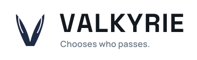

<p align="center">
  <picture>
    <source media="(prefers-color-scheme: dark)" srcset="assets/brand/logo-horizontal-dark.svg">
    
  </picture>
</p>

# Valkyrie

**Chooses who passes.**

Valkyrie is a homegrown MCP / tool-calling platform for production multi-agent AI systems. Like its namesake, it decides who passes. It is built on one rule: agents *propose* actions, Open Policy Agent *decides* whether each one is allowed, and the Valkyrie gateway *executes* the allowed ones with a short-lived credential. Agents never hold credentials and never reach a system directly.

```
                     registryd (control plane) ── signed bundle ──► OPA sidecar
                          │ registry snapshot                          ▲ verdict
agents · IDE clients ──► Valkyrie gateway (Go) ────────────────────────┘
                              │
                              ├──► first-party MCP servers (Python)
                              ├──► third-party MCP servers (any language, e.g. @modelcontextprotocol/server-everything)
                              └──► plain REST APIs via HTTP adapters
```

## What you get

| | |
|---|---|
| **Gateway** (`gateway/`) | Standard-library Go. Seven-step pipeline: authenticate (OIDC/JWKS) → resolve + rate-limit → validate → ask OPA → lease credential (signed lease, Vault, static, none) → execute (MCP or HTTP adapter) → redact + audit + metrics. Two faces: `POST /v1/tools/invoke` for agents and `POST /mcp` (Streamable HTTP) for Claude Code, Cursor and any MCP client. Semaphore and circuit breaker per upstream, Redis-backed idempotency and rate limits, Prometheus `/metrics`, production config guard. Fail-closed. |
| **Control plane** (`controlplane/`) | `registryd`: publishes manifests with a live contract test against the server, binds roles, serves the registry snapshot to gateways (ETag) and the **signed OPA bundle** to sidecars, keeps a change log. `valkyriectl`: `publish`, `role bind`, `tools`, `changes`, and `import-mcp` to onboard any existing MCP server in one command. |
| **Policies** (`policies/`, `policy-corpus/`) | Rego v1. Every call gets a *verdict*: allow, deny with a reason, or approval required, plus obligations. Role-to-tool binding, risk tiers, tenant isolation, dietary-safety and budget rules for the demo, approval tickets for financial actions, PII redaction obligations. 22 unit tests at 97% coverage plus a regression corpus replayed on every change. |
| **Registry** (`registry/`) | One YAML manifest per tool — owner, schema, risk tier, credential scope, limits. Nothing unregistered can run; servers refuse to start with an unregistered tool. |
| **SDK** (`sdk/python/valkyrie`) | `GatewayClient` for agents (a deny is a result with a reason, not an exception). `make_server()` scaffold for MCP servers: scope-checked credentials, registry check, health. |
| **Servers** (`servers/`) | Five Python MCP servers for the demo: profile, menu, orders, payments, delivery. Each verifies the gateway's signed lease cryptographically. |
| **Reference** (`reference/`) | Onboards two things nobody on the platform wrote: the official TypeScript `server-everything` (Streamable HTTP, sessions, SSE) via `valkyriectl import-mcp`, and a plain REST weather API via an HTTP-adapter manifest. `make reference` runs it. |
| **Agents** (`agents/pizza`) | LangGraph supervisor + two specialists, human-in-the-loop via `interrupt`, offline deterministic planner so CI needs no API key. |
| **Deploy** (`deploy/`) | docker-compose; Kubernetes with the OPA sidecar in the gateway pod, per-server Deployments and a NetworkPolicy. |

## Try it in five minutes

```bash
git clone https://github.com/<owner>/valkyrie && cd valkyrie
make deps && make demo
```

You will watch an agent try to order a dish its customer is allergic to, the policy gate refuse it with a reason, and the agent recover — every decision in the audit log with a policy version. Then `make reference` onboards a third-party MCP server and a REST API through the control plane without restarting anything. Prerequisites: Go 1.24+, Python 3.10+, Node 18+ (for the reference server), and the `opa` binary on `PATH`.

Release binaries and container images (`ghcr.io/<owner>/valkyrie-gateway`, `valkyrie-registryd`, `valkyrie-server-*`) are published on every tagged release.

## Quick start

```bash
make deps     # Python deps; needs Go 1.24+, Python 3.10+, opa on PATH
make test       # registry build · opa test + corpus · go test -race (gateway, control plane) · pytest
make demo       # the pizza scenario, end to end, against a live stack (registryd → OPA → servers → gateway)
make smoke      # the /mcp face, driven by the official MCP client
make reference  # onboard server-everything + a REST API through the control plane, call both
make e2e        # all of the above on one stack (CI)
```

`make demo` asks the agents to order dinner for a vegetarian customer with a nut allergy and a $25 budget. The ordering agent's first choice is the pesto pasta; the policy gate refuses it (`allergen_conflict: Pesto Pasta contains tree_nuts`), the agent reads the reason and orders the Margherita instead. Every decision is in `.dev/audit.jsonl` with a decision id and policy version.

Read **[docs/DEVELOPER_GUIDE.md](docs/DEVELOPER_GUIDE.md)** for how to add a tool, write a policy, build a server and an agent, and what to replace before production.

## Design principles

1. **One chokepoint.** Every tool call goes through the gateway; the gateway asks OPA before anything runs.
2. **Policy is data, not prompt.** Rego decides; the model only proposes.
3. **Durable graphs.** LangGraph checkpoints so a run can pause for approval and survive a restart.
4. **Tools are products.** A manifest, an owner, a tier, a schema, tests. Onboarding is a pull request.
5. **Deny is a normal result.** Agents receive a reason and re-plan.

## Language choices

Gateway in Go (goroutine-per-connection, `context` cancellation, one static binary for the one process that holds credentials). Servers in Python by default (thin, I/O-bound adapters owned by the teams closest to the systems), promoted to Go individually when a p99 says so. Rust for sandboxed execution if you have Rust engineers. The gateway's per-server isolation is what makes the server-language choice low-stakes.

## License

Open core. The gateway, SDK, policies, servers, agents, reference and docs are **MIT** (`LICENSE`). The control plane — `controlplane/` (registryd, valkyriectl) — is under the **Valkyrie Enterprise License** (`controlplane/LICENSE`): free to evaluate, develop and test; production use needs a commercial license. Third-party notices are in `NOTICE`; contribution terms in `CONTRIBUTING.md`.
